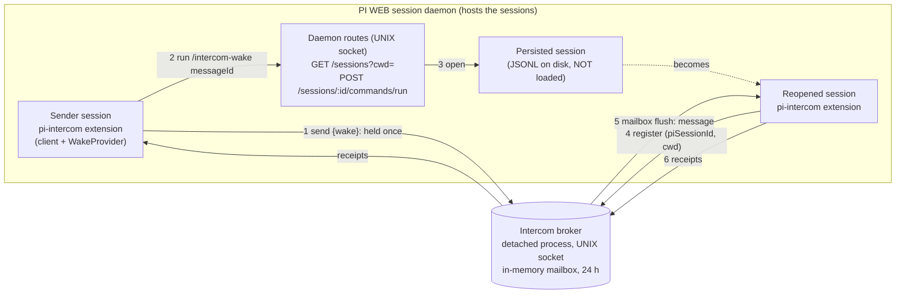
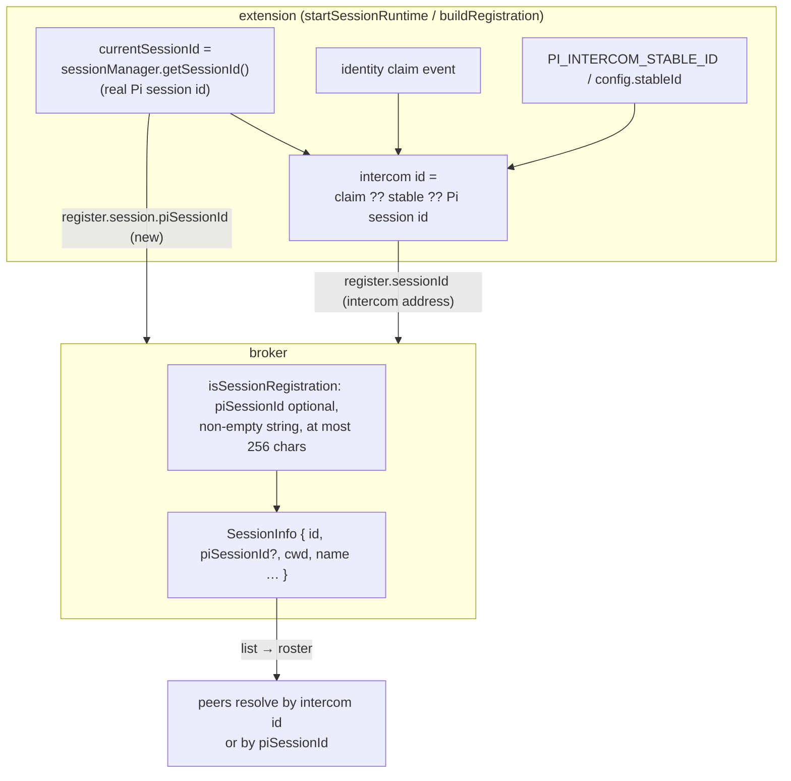
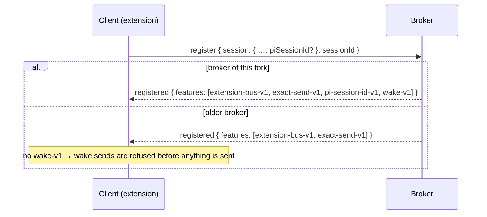
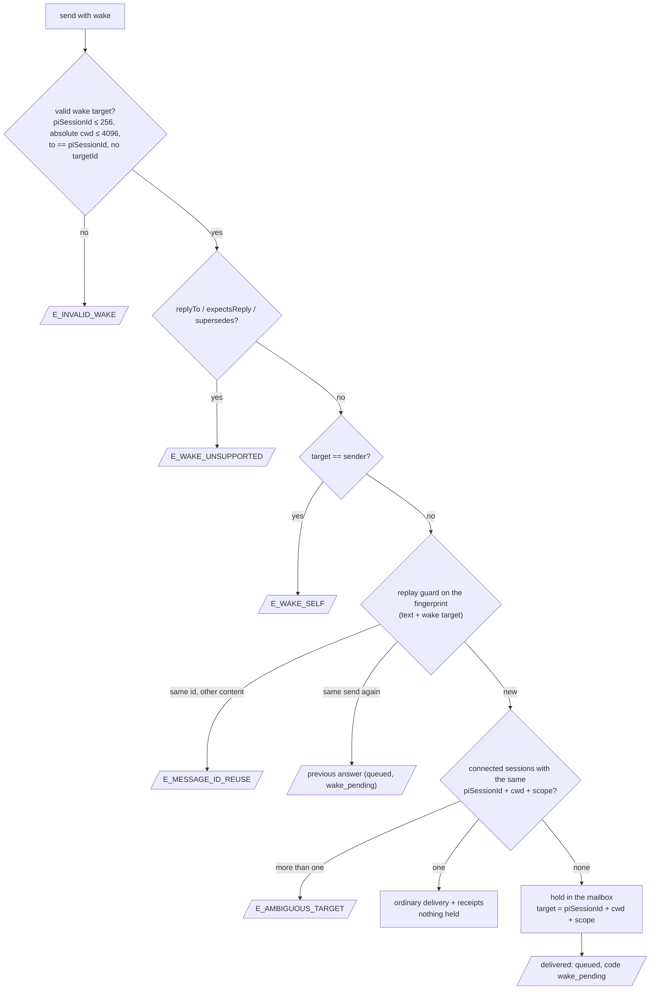
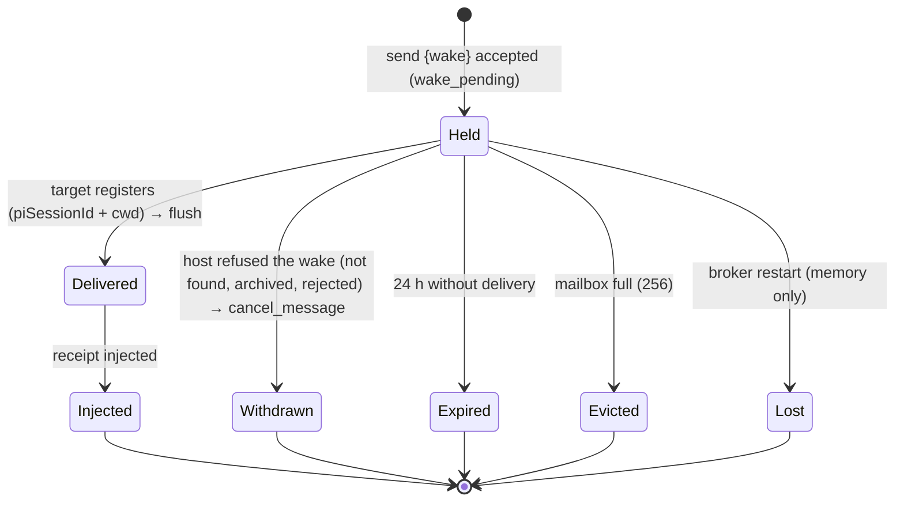
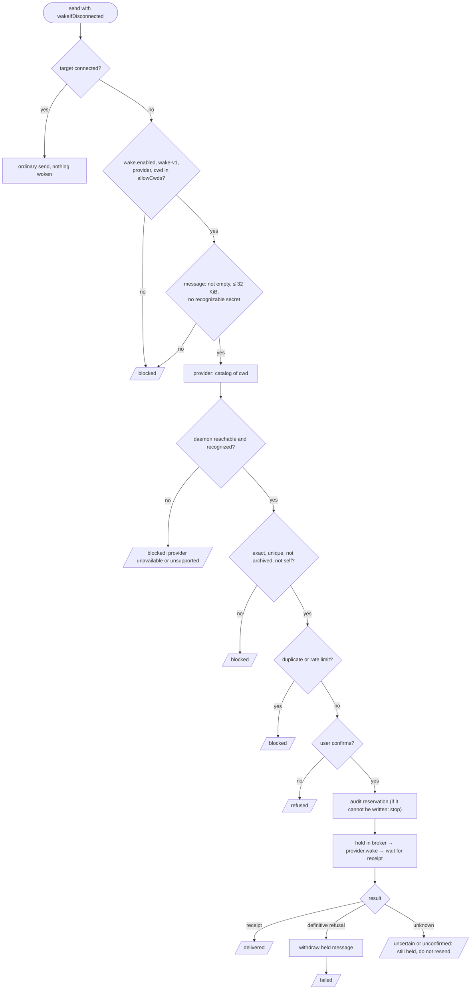
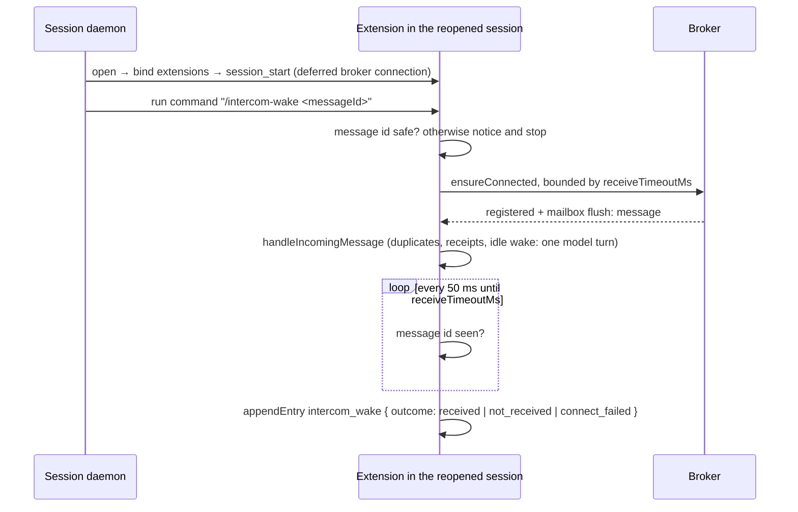
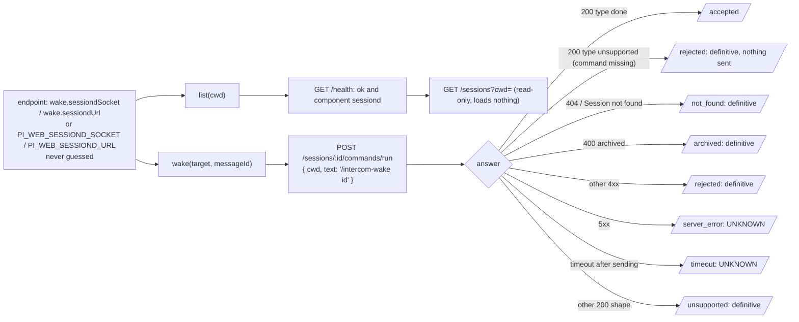

# Waking persisted sessions — architecture

This fork of `pi-intercom` lets a message reach a Pi session that is **persisted but not loaded** (for example a saved PI WEB conversation). The message is held once in the broker, the original session is reopened through a *wake provider*, and the message is then delivered through the normal intercom path. Diagrams are Mermaid.

User-facing behavior and settings are in the main [README](../../README.md#waking-persisted-sessions); installation and rollback are in [INSTALL.md](./INSTALL.md).

## 1. Components



- The **broker never talks to the host.** It is shared by every session (TUI, CLI, PI WEB). The sender's extension reopens the session through its `WakeProvider`.
- The message lives in **one place** (the mailbox). The wake command carries only the message id.
- Delivery is the ordinary intercom path: duplicate suppression by id, receipts, `replyTo` tracking, the shared idle wake.

## 2. Identity: intercom id ≠ Pi session id



With a stable id or an identity claim, the intercom id is not the Pi session id, but a host can only reopen a session by its Pi session id. The field is self-asserted by the local client, like `cwd` and `pid`.

## 3. Protocol negotiation and compatibility

`INTERCOM_PROTOCOL_VERSION` stays **1**: the health check compares it for equality, so a bump would make every older broker look unhealthy. New behavior is negotiated with additive features in `registered.features`, like `exact-send-v1`.



| Client | Broker | Result |
|---|---|---|
| new | new | `piSessionId` in the roster; wake available |
| new | old | the old broker ignores the new fields; wake refused with a clear error; ordinary sends unchanged |
| old | new | no `piSessionId`; behavior identical to upstream |

| Protocol element | Where |
|---|---|
| `pi-session-id-v1`, `SessionRegistration.piSessionId?`, `SessionInfo.piSessionId?` (≤ 256 chars) | `types.ts`, `broker/protocol.ts`, `broker/broker.ts` |
| `wake-v1`, `WakeTarget { piSessionId, cwd }`, `send.wake?` | `types.ts`, `broker/protocol.ts` (`isWakeTarget`), `broker/broker.ts` (`handleWakeSend`) |
| `delivered.code = "wake_pending"` (also on replays) | `broker/broker.ts` |
| errors `E_INVALID_WAKE`, `E_WAKE_UNSUPPORTED`, `E_WAKE_SELF` | `broker/broker.ts`, `broker/client.ts` |
| delivery fingerprint includes the wake target | `broker/protocol.ts` |

## 4. End-to-end flow

```mermaid
sequenceDiagram
    autonumber
    participant U as User / model
    participant S as Sender (extension)
    participant B as Broker
    participant P as WakeProvider (pi-web-sessiond)
    participant D as Session daemon
    participant T as Target (persisted → reopened)

    U->>S: intercom send { to, cwd, message, wakeIfDisconnected: true }
    S->>S: target connected? (roster: piSessionId, intercom id, or exact name in cwd)
    alt connected
        S->>B: ordinary send
    else not connected
        S->>S: checks: wake.enabled, wake-v1, allowCwds, message, confirmation available
        S->>P: list(cwd)
        P->>D: GET /health, GET /sessions?cwd= (read-only)
        P-->>S: exact Pi session id (full id, or exact name unique in cwd; never archived)
        S->>S: not self, duplicate window, rate limits (shared audit)
        S->>U: confirmation dialog
        S->>S: audit: reservation
        S->>B: send { wake: { piSessionId, cwd } }
        B->>B: hold ONCE in the mailbox (target = piSessionId + cwd + scope)
        B-->>S: delivered: queued, code wake_pending
        S->>P: wake(target, messageId)
        P->>D: POST /sessions/:id/commands/run { cwd, text: "/intercom-wake <messageId>" }
        D->>T: open → bind extensions (session_start) → run the command
        Note over T: extension commands run before input handlers and the model: no model call
        T->>B: register { piSessionId, cwd }
        B->>T: mailbox flush: the message
        T->>B: receipts (receiver_received, injected …)
        B-->>S: receipt
        Note over T: normal idle wake: one model turn, caused by the message
        S->>S: audit: outcome (hash and length of the text, never the text)
    end
```

No double execution:
- the wake command is consumed by Pi as a command (no model turn);
- the message exists once (mailbox) and is delivered once (receiver duplicate suppression, broker replay guard);
- if the target reconnects on its own meanwhile, the flush happens once and the command is a no-op;
- the decision to wake comes from the broker's answer (`queued`), not from an earlier roster read, so a race cannot deliver twice.

### 4.1 Broker: `handleWakeSend`



Matching at flush (`matchesWakeTarget`): same scope **and** same directory (`sameCwd`) **and** equal `piSessionId`; for an older client that reports no `piSessionId`, its intercom id must equal the Pi session id. Never by name, never in another directory.

### 4.2 Lifecycle of a held message



## 5. Sender decision tree



## 6. Receiver: `/intercom-wake`



The command is registered unconditionally, even with intercom or wake disabled, so a reopened session always consumes the prompt as a command.

## 7. The `pi-web-sessiond` provider (experimental)



- These are **internal, unsupported** PI WEB routes. Any unexpected answer is a refusal.
- No other session route is called: status, messages and snapshots also open a session.
- `commands/run` is used instead of `/prompt` because it runs only commands the session has. With `/prompt`, a session whose intercom is missing or too old would receive `/intercom-wake …` as a prompt for its model. It also does not echo the command in the UI.
- A definitive error withdraws the held message (`cancel_message`); an unknown outcome leaves it held and tells the caller not to resend.
- Another host can register its own provider (`registerWakeProvider`).

## 8. Policy, limits and audit

- Off by default (`wake.enabled`), restricted to `wake.allowCwds`, confirmed by the user (`wake.confirm: "always"` blocks without a UI).
- Messages that look like secrets (tokens, private keys, password assignments) or exceed 32 KiB are refused.
- Duplicate window and per-session / global rate limits are computed from the **audit file**, which every session of the user shares, so they hold across processes. A reservation is written before the wake and the limits are checked again with it counted, which closes the race between two sessions. A reservation whose attempt ends `failed` (the host refused, nothing happened) does not count.
- Audit: `wake-audit.jsonl` next to `config.json`, mode 0600, bounded by entries and age. It records time, outcome, ids, directory, daemon version, text length and SHA-256 — **never the text**. If it cannot be written, nothing is woken.

## 9. Sessions that are already open and busy

A session can be loaded in PI WEB but missing from the intercom roster (opened a moment ago, or with its intercom disconnected), so the sender treats it as persisted. Verified on an isolated daemon with a scripted local model (`scripts/e2e/run.sh busy`):

| Session state | `commands/run` (used) | `/prompt` (not used) |
|---|---|---|
| model turn in progress | command runs at once (~1 s), no model call, turn completes | same |
| compaction in progress | command runs right after the compaction, no model call | same |
| `ask_user` form open | **the form is closed as unanswered** (PI WEB does this before running any prompt or command); no turn | same |
| command not registered (intercom missing or old) | refused (`unsupported`), nothing reaches the model | **the text reaches the model as a prompt** |
| archived / missing session | 400 / 404 | 400 / 404 |

The closed form is the one side effect that cannot be avoided from intercom; the confirmation dialog mentions it.

## 10. Files

| File | Content |
|---|---|
| `types.ts` | features, `WakeTarget`, `wake_pending`, limits |
| `broker/protocol.ts` | `piSessionId` validation, `isWakeTarget`, fingerprint |
| `broker/broker.ts` | roster `piSessionId`, features, `handleWakeSend`, `matchesWakeTarget`, exact flush |
| `broker/client.ts` | `send({ wake })`, fail-closed without `wake-v1` |
| `config.ts` | `wake` section (off by default), strict validation |
| `wake/provider.ts` | `WakeProvider`, `WakeError` (definitive vs unknown), registry, command constants |
| `wake/resolve.ts` | exact resolution: full id, or exact unique name; never prefixes; archived refused |
| `wake/policy.ts` | allowlist, secret-like content, size, duplicates, rate limits |
| `wake/audit.ts` | JSONL 0600, hash and length, retention, tolerant reader |
| `wake/controller.ts` | `performWake`, `findLiveWakeTarget` |
| `wake/sessiond.ts`, `wake/builtin.ts` | PI WEB provider and its registration |
| `index.ts` | tool option `wakeIfDisconnected`, `sendWithWake`, `/intercom-wake`, `/intercom-wake-status` |
| `scripts/test-isolated.sh` | runs the suite without touching a live broker |
| `scripts/e2e/` | end-to-end checks on an isolated PI WEB daemon and broker (`wake`, `busy`) |
| `scripts/ops/` | broker swap under the spawn lock, broker probe, production wake check |

## 11. Testing

- Unit: `broker/protocol.test.ts`, `config.test.ts`, `wake/*.test.ts` (including a fake session daemon on a UNIX socket).
- Integration: `intercom.integration.test.ts` — real broker, two extension harnesses, fake provider.
- End to end: `scripts/e2e/run.sh` starts a PI WEB session daemon and a broker in a throwaway directory with a cleaned environment, writes a persisted session that was never loaded, and checks the whole flow (23 checks); `scripts/e2e/run.sh busy` covers sessions that are already open and busy. Each run stops only the processes it started and removes its directory.
- Run the suite with `scripts/test-isolated.sh`: inside a Pi session, `PI_CODING_AGENT_DIR` would otherwise point the tests at the live broker.
